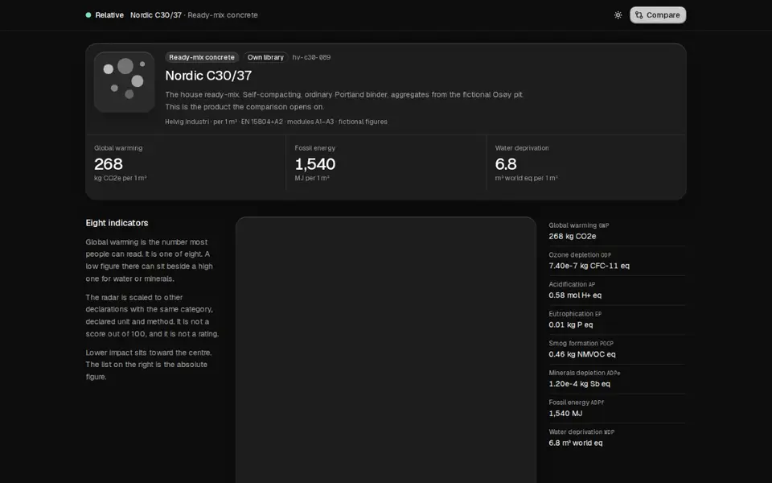
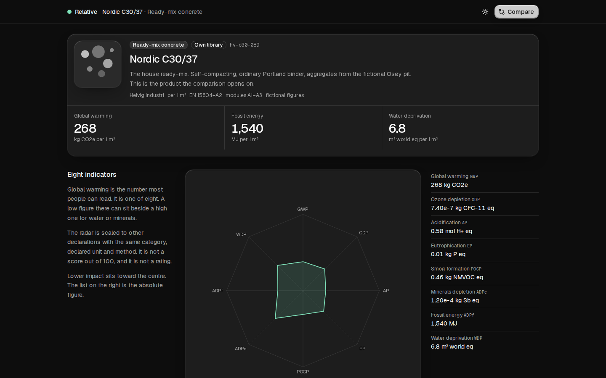
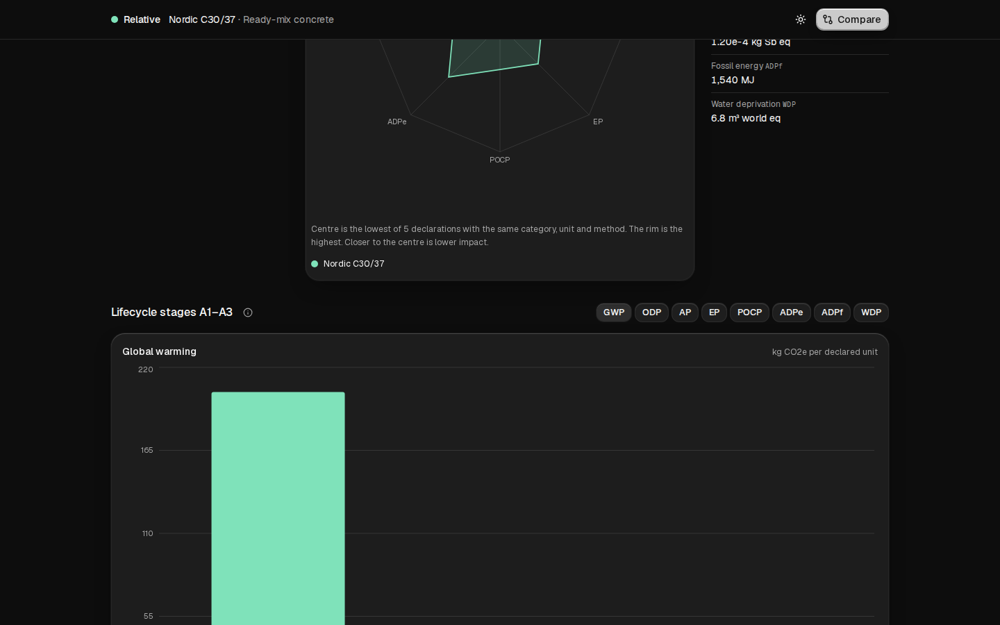
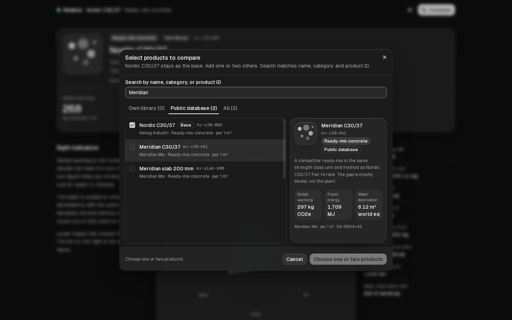
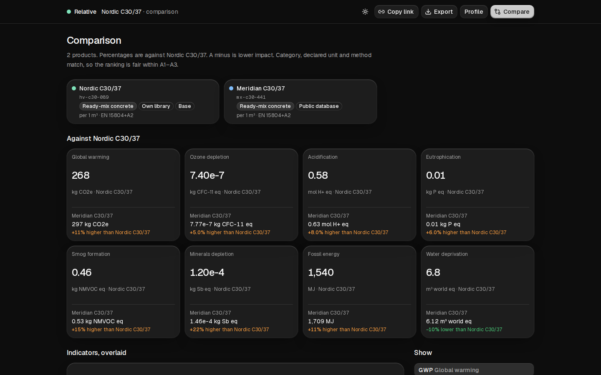
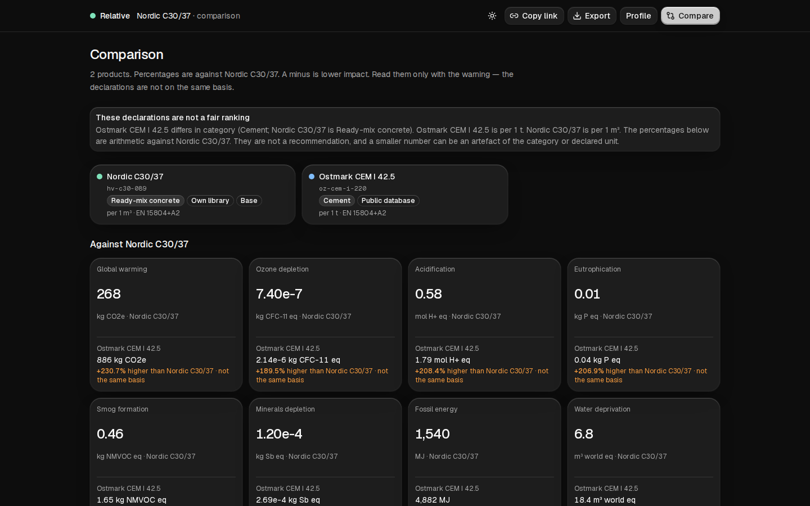

[](https://github.com/sergushkincom/impact-compare/actions/workflows/ci.yml)
[](https://github.com/sergushkincom/impact-compare/blob/main/LICENSE)
[](https://impact-compare.vercel.app)

# Relative

**The question:** when the only number anyone can read is kilograms of CO2e, how do you show whether one product is actually better — and which part of its life makes the gap?

Prototype only, fictional data, not affiliated with any vendor.

[Live demo →](https://impact-compare.vercel.app)



*Profile, then the public database, then the gap. A minus is lower impact.*

## Try it in 30 seconds

1. Open the app. It starts on **Nordic C30/37**, a fictional ready-mix.
2. Read the three headlines, then the radar. The centre is the lowest peer, not a score out of 100.
3. Press **Compare**. Open **Public database**, search `Meridian`, tick **Meridian C30/37**.
4. The tiles say how far it sits from Nordic. The stage bars say whether the gap is raw materials, transport, or the plant.
5. Copy the link. The selection is the URL: `/products/hv-c30-089?with=mx-c30-441`.

To see the warning, compare Nordic with **Ostmark CEM I 42.5** or **Meridian slab 200 mm**. Different category, unit, or method, and the percentages stop pretending to be a ranking.

## What it is

A sustainability manager at a materials company has one product's environmental declaration in front of them: global warming, fossil energy, water, and five indicators almost nobody outside the field can name. The numbers are cradle-to-gate, modules A1–A3, in the shape of an EN 15804 declaration. Alone, they are hard to judge. The useful question is comparative. Against another of our mixes, or against a competitor from a public database, which one is lower, and where does the difference actually come from?

Relative is that comparison. Twenty fictional products — cement, ready-mix, rebar, brick, insulation, timber — some in the company's own library, some marked public. The figures are made up. They sit in a plausible range so the shape of the decision is real and the numbers are not.



*Profile — global warming, fossil energy, water. The radar is peers with the same category, unit and method. Closer to the centre is lower impact.*



*Stages — A1 raw materials, A2 transport, A3 manufacturing. One indicator at a time, so the axis stays honest. Under it, where that indicator comes from.*

## The decision moment

The manager does not need another dashboard of a single product. They need to answer a procurement question before a meeting: is the competitor's C30 actually better, or does it only look better because the declaration is per square metre, or calculated under an older method?

The moment is the comparison. Two or three products, one of them the base, percentages against that base, and a sentence that says whether those percentages are allowed to be a ranking.



*Search — name, category, or product ID. Own library, public database, or all. The card follows hover and keyboard focus.*



*Fair comparison — same category, same cubic metre, same method. Orange is higher impact. Green is lower. Water goes the other way from global warming.*



*Not fair — cement per tonne against concrete per cubic metre. The chart stays. The warning says not to treat the percentage as a winner.*

## Design decisions I'd defend

**Own library and the public database are tabs, not a badge on one mixed list.** The job splits in two: another of ours, or the market. A count on the tab tells you how small the set is. Search covers name, category and product ID, and the maker, because that is how a public declaration is asked for.

**The comparability warning does not hide the chart.** Category, declared unit, or calculation method — if any of them differ, a lower number is not a better product. Hiding the figures feels like the tool refusing to help. Showing them without the warning invites someone to quote a percentage that is an artefact of the unit. The warning stays on screen, the deltas say "not the same basis", and nothing is styled as a winner.

**Two or three products, and the one you opened is the base.** A percentage needs one denominator. A radar with four polygons becomes a knot you have to decode with a legend. Three is the last count where you can still see which line is which, and where the stage chart can put a bar per product without becoming a table.

**The radar and the stages stay on the same page.** The radar says which indicator differs. The stages say whether that difference is raw materials, transport, or manufacturing. Neither answers the procurement question alone. Each stage chart is one indicator, because kilograms of CO2e and a trace gas do not share an axis.

## What I found by building it

A product can be better on global warming and worse on water in the same comparison. Nordic against Meridian is that case. If the screen only offers GWP, the manager never sees the trade.

The centre of the radar has to be the better end, and the caption has to say so. A bigger polygon reads as "more". More impact is worse. Scaling each axis from the lowest value in the set to the highest makes a small shape mean lower impact — among these products, not in the abstract.

Percent change against a negative global warming (timber, biogenic carbon in the total) points the right way only if you divide by the absolute value. Divide by the raw negative and "lower" flips. The manufacturing stage of that timber is still a positive emission. The total hides it. The stage chart does not.

People will compare a cubic metre of concrete with a square metre of slab, and a current declaration with an older method whose acidification unit is not the same unit. The search will not stop them. The warning is there because the search is not enough.

## Deliberately not built

No product passports. No tenders. No supplier requests. No company-level reports. No use phase or end of life (A4–D). No verification workflow. No weekly date filter — an EPD is not a time series.

## What I'd test next

Five people, one task: which product is better on water, and why. I want to know whether they read the centre of the radar as "good" without the caption.

The same five, with the unit mismatch on screen. Do they still quote the percentage, or does the warning actually stop the sentence?

And the default tab. Own library first assumes the second product is one of ours. If the real question is usually the competitor, the public database should be the tab that opens.

## Running it

```bash
pnpm install
pnpm dev
```

→ http://localhost:3000

The Live badge points at `impact-compare.vercel.app`. That address answers once the repo is connected to Vercel. Until then it is a placeholder.

Checks, same as CI:

```bash
pnpm run typecheck
pnpm run lint
pnpm test
pnpm run test:e2e
```

## Stack

Next.js (App Router) · React 19 · TypeScript · Tailwind CSS 4 · shadcn/ui · [Solid Glass](https://github.com/deeplethe/solid-glass) · Motion · Recharts · Vitest · Playwright · pnpm

Node 22, pinned in `.nvmrc` and `package.json` `engines`. CI is `.github/workflows/ci.yml`: install, typecheck, lint, unit tests, production build, Playwright.

## Credits

The material is [Solid Glass](https://github.com/deeplethe/solid-glass) by [DeepLethe](https://github.com/deeplethe), MIT. Thick, smoky glass: fine borders, a line of light on the edge, colour kept for the few things that mean something. Site: [deeplethe.github.io/solid-glass](https://deeplethe.github.io/solid-glass). The stylesheet ships as `app/solid-glass.css`.

Components are [shadcn/ui](https://ui.shadcn.com) on Base UI. Icons are Lucide.
